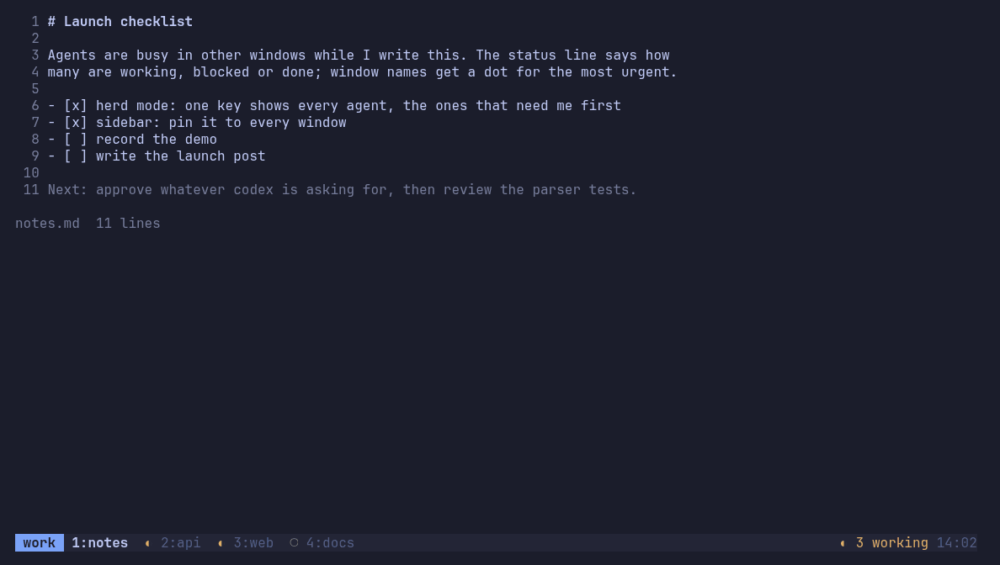

# tmux-agent-herd

[](https://github.com/kashym/tmux-agent-herd/actions/workflows/ci.yml)
[](https://github.com/kashym/tmux-agent-herd/releases)
[](LICENSE)

**Know which of your coding agents needs you, without leaving tmux.**

You run Claude Code in one pane, Codex in another, pi in a third. One is
waiting for permission, one finished ten minutes ago, one is still working, and
you only find out by flipping through panes. tmux-agent-herd gives tmux
agent awareness: every agent's state in your status line, a notification when
one needs you, and **one key** that shows them all and takes you there.



Works with **Claude Code, Codex CLI, Gemini CLI, GitHub Copilot CLI, OpenCode,
pi and aider**, and anything else that can run a script. Plain tmux 3.3+,
Linux and macOS.

Inspired by [herdr](https://github.com/ogulcancelik/herdr), which builds agent
awareness into its own multiplexer. tmux-agent-herd brings the same idea to
the tmux you already have: your sessions, config, plugins, SSH workflow and
muscle memory stay exactly as they are.

## Install

With [TPM](https://github.com/tmux-plugins/tpm):

```tmux
set -g @plugin 'kashym/tmux-agent-herd'
```

Press `prefix + I`. The `herd` binary is downloaded (checksum-verified) for
your platform, or built from source if Go is available and no release matches.

Then connect your agent CLIs, from any pane:

```sh
herd setup all       # shows each change as a diff and asks first; backs up files
herd install-skill   # optional: lets your agents use herd themselves
```

<details>
<summary>Without TPM: one script does everything</summary>

```sh
curl -fsSL https://raw.githubusercontent.com/kashym/tmux-agent-herd/main/install.sh | bash
```

It checks tmux and git, offers to install TPM if you don't have it, clones the
plugin where TPM keeps plugins, adds it to your tmux config, connects the agent CLIs it finds and offers the skill.
Every change needs a yes and edited files are backed up. Read it first if you
like (`--help` for options); `--uninstall` undoes it.
</details>

<details>
<summary>Dotfiles or Nix-managed configs</summary>

`herd setup --print <name>` prints what herd would add to an agent CLI's
config instead of writing it, so you can put it in your dotfiles. The installer
never writes to a read-only tmux config; it tells you the line to add.
</details>

## Use it

Press **`prefix + a`** for **herd mode**: a dashboard docked on the left of
your screen as a popup, so your layout and pane numbers never change.

| In herd mode | |
| --- | --- |
| `j` `k` / click | move |
| `Enter` | go to that agent (or session) and close |
| `B` `D` | go to the next **blocked** / **done** agent |
| `/` | filter by agent, session, path or message |
| `s` | type a prompt and send it to the agent |
| `x` | kill the agent's pane |
| `p` | **pin**: keep a sidebar in every window, herdr-style (`p` again unpins) |
| `Esc` `q` | close |

| State | Meaning |
| --- | --- |
| `●` **blocked** | waiting for you: a permission prompt, a question, or a login |
| `◐` **working** | busy |
| `✓` **done** | finished and you haven't looked yet. Turns into idle when you focus it |
| `✗` **error** | the last turn failed, e.g. the provider returned an error |
| `○` **idle** | waiting for a new prompt |

The status line shows the counts, window names get a dot with their most
urgent state, and you get a desktop notification when an agent you're not
looking at becomes blocked or done (at most one per pane every 30 s).

**Prefer direct keys?** All are off by default and only ever bound if free:

```tmux
set -g @herd-blocked-key 'B'   # jump to the agent waiting on you
set -g @herd-done-key 'D'      # jump to the agent that just finished
set -g @herd-sidebar-key 'S'   # toggle a sidebar pane in this window
set -g @herd-sidebar on        # start pinned: a sidebar in every window
```

## A good tmux citizen

- **Binds one key, and never one you use.** If `prefix + a` is already bound
  (say `send-prefix` with a `C-a` prefix), herd leaves it alone, tells you once,
  and you pick another with `@herd-key`.
- **Your status line, your call.** Put `#{herd}` in `status-left` or
  `status-right` and `#{herd_badge}` in your window formats, and herd fills in
  exactly those. Without placeholders it appends to `status-right` and puts a
  dot in front of window names (`@herd-status off`, `@herd-window-badge off`).
- **State is plain tmux.** Every pane gets `@herd_state`, `@herd_agent` and
  `@herd_msg` options, and the global `@herd_status` is the summary: use them in
  any format, theme or script.
- **Cheap.** One small daemon per tmux server polls once a second, only looks
  at agent panes, skips screens that didn't change, and writes options only on
  change: under 1% CPU with 10 agents, nothing runs per status redraw. It exits
  with the server.
- **Auditable and removable.** `herd doctor` lists every key, hook, option and
  file herd touched. `herd setup --remove all` and `install.sh --uninstall`
  take it all back out.

## Supported agent CLIs

| Agent CLI | `herd setup <name>` installs | Reports |
| --- | --- | --- |
| Claude Code (`claude`) | hooks in `~/.claude/settings.json` | working, blocked, done |
| Codex CLI (`codex`) | `~/.codex/hooks.json`, then **trust them once with `/hooks` in Codex** | working, blocked, done |
| Gemini CLI (`gemini`) | hooks in `~/.gemini/settings.json` | working, blocked, done |
| GitHub Copilot CLI (`copilot`) | `~/.copilot/hooks/herd.json` | working, blocked, done, error |
| OpenCode (`opencode`) | plugin `~/.config/opencode/plugins/herd.js` | working, blocked, done, error |
| pi (`pi`) | extension `~/.pi/agent/extensions/herd.ts` | working, blocked, done, error |
| aider (`aider`) | `notifications-command` in `~/.aider.conf.yml` | done (the rest from the screen) |

Without setup, agents are still detected from their process and screen; hooks
make the state exact and instant.

```sh
herd setup --list            # what's installed and what's connected
herd setup codex pi          # connect specific ones
herd setup --remove all      # take herd back out
```

**Your agent isn't listed?** Call the adapter from its hooks:

```sh
"$HERD_HOOK" --agent mytool working
"$HERD_HOOK" --agent mytool --kind permission --msg "Approve rm?" blocked
"$HERD_HOOK" --agent mytool done     # also: idle, error, none
```

`$HERD_HOOK` is set in every tmux pane (it's `scripts/herd-hook` in the plugin
directory). It never prints and always exits 0, so it can't break your agent. Add the
command name to `@herd-agents` and
[open an issue](https://github.com/kashym/tmux-agent-herd/issues/new?template=new_harness.yml)
so it can be supported out of the box.

## Let your agents run other agents

`herd` is also a small, scriptable CLI (every command has `--json`) for
starting workers in new panes, handing them tasks and waiting for results:

```sh
herd run --name tests --right codex          # start an agent in a new pane
herd send tests "fix the failing test" --enter
herd wait tests --for done,blocked --timeout 1800
herd read tests --lines 60
herd ls --json
```

`herd install-skill` teaches this to every installed agent CLI that supports
[Agent Skills](https://agentskills.io). Safety rails: agents can only type into
and close panes in their own tmux session, never close their own pane, and
can't type into a working agent without `--force`. Run `herd help` for
everything.

## Configure

| Option | Default | Effect |
| --- | --- | --- |
| `@herd-key` | `a` | Opens herd mode (`off` to disable). Skipped if already bound |
| `@herd-mode-width` | `32` | Width of herd mode and sidebars |
| `@herd-sidebar` | `off` | `on`: start pinned, a sidebar in every window |
| `@herd-blocked-key` `@herd-done-key` `@herd-sidebar-key` `@herd-picker-key` | `off` | Optional direct keys (jump to blocked, jump to done, toggle sidebar, fzf picker) |
| `@herd-agents` | `claude codex gemini copilot opencode pi aider` | Commands treated as agents |
| `@herd-status` | `on` | Append the summary to `status-right` when you haven't placed `#{herd}` |
| `@herd-window-badge` | `on` | Dot in front of window names when you haven't placed `#{herd_badge}` |
| `@herd-border` | `off` | Agent, state and message in pane borders |
| `@herd-notify` | `blocked,done` | States that notify (`off` to disable) |
| `@herd-notify-cmd` | auto | Your own notifier: `sh -c "$cmd" herd <title> <body>` |
| `@herd-path` | `on` | Add the plugin's `bin/` to PATH for new panes (`$HERD_BIN` is always set) |
| `@herd-poll-ms` | `1000` | Screen check interval |
| `@herd-stale-after` | `600` | Seconds before a hook-reported state is distrusted |
| `@herd-patterns-dir` | | Extra screen-pattern directory |

## Uninstall

TPM: remove the line and press `prefix + alt + u`, then run
`herd setup --remove all` to take herd out of your agent CLIs. With the script:
`curl -fsSL https://raw.githubusercontent.com/kashym/tmux-agent-herd/main/install.sh | bash -s -- --uninstall`.

## Troubleshooting

Start with **`herd doctor`**: it shows what herd changed, whether the daemon
runs, key conflicts and which agent CLIs are connected.

- **`prefix + a` does nothing.** It was already bound, so herd left it alone
  (doctor says so). Set `@herd-key` to a free key.
- **Nothing in the status line.** A theme loaded after herd replaced
  `status-right`. Put `#{herd}` in your theme's status line, or load herd last.
- **An agent isn't detected.** Check `herd ls` for its `COMMAND` and add it to
  `@herd-agents`.
- **States are wrong or late.** Connect the agent CLI (`herd setup --list`);
  for Codex, trust the hooks with `/hooks`. Restart running agent sessions.
- **`herd: command not found`** in an old pane: open a new one, or use
  `$HERD_BIN`. If `herd` is another program (Laravel Herd), the skill already
  uses herd's absolute path.

`herd log` shows every state change and its source; the daemon log is in
`~/.local/state/herd/herdd.log`. Please include both in
[a bug report](https://github.com/kashym/tmux-agent-herd/issues/new?template=bug_report.yml).

## How it works

`herdd` (part of the `herd` binary, one per tmux server) keeps each pane's
state, taken from the most trustworthy source that reported recently: agent
hooks and extensions (instant), then per-agent screen patterns in
`patterns/`, then the process name. It writes the result into tmux options,
which your status line, herd mode and the sidebars read. Every change is logged
to `~/.local/state/herd/events.jsonl`. Background: the
[original design doc](docs/DESIGN.md).

## Contributing

Issues and PRs are very welcome, especially **support for more agent CLIs**
and **real screen captures** that improve detection. `scripts/demo.sh` starts a
throwaway tmux with fake agents to try changes. See
[CONTRIBUTING.md](CONTRIBUTING.md).

## License

[MIT](LICENSE)
